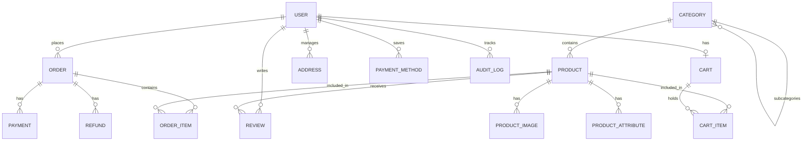

# HappyPets Admin Dashboard


A powerful, high-performance E-commerce Admin Dashboard tailored for managing premium pet supplies. Designed for scalability and exceptional user experience, the HappyPets dashboard provides administrators with robust tools for order management, bulk product operations, and dynamic reporting.

---

## Table of Contents

1. [Project Overview & Features](#project-overview--features)
2. [Security & Accessibility](#security--accessibility)
3. [Architecture & ERD](#architecture--erd)
4. [Performance Analysis](#performance-analysis)
5. [Getting Started](#getting-started)
6. [Usage Guide](#usage-guide)

---

## Project Overview & Features

HappyPets Admin Dashboard streamlines e-commerce operations with a focus on speed and productivity:

- **Structured Admin Sidebar**: Intuitive navigation layout ensuring quick access to inventory, orders, and customer management.
- **Custom Date PDF Reporting**: Dynamically generate detailed sales and inventory reports in PDF format based on custom date ranges.
- **Bulk Product Upload**: Quickly populate the catalog using CSV bulk import functionality, saving hours of manual data entry.
- **Dual-Status Order Management**: Advanced order tracking that distinctly separates **fulfillment status** (Processing, Shipped, Delivered) from **payment status** (Pending, Paid, Failed) for granular operational control.

---

## Security & Accessibility

### Security Protocols
- **Data Encryption**: All Personally Identifiable Information (PII) and passwords are securely encrypted using industry-standard hashing algorithms (bcrypt).
- **Strict Role-Based Admin Promotion**: Implements the Principle of Least Privilege. Standard admins cannot elevate privileges; only a designated `superadmin` can promote or demote other users.
- **Audit Logging**: Critical administrative actions are tracked for security and compliance.

### Frontend Accessibility
- **Responsive Design**: Flawlessly adapts to any screen size, ranging from **320px mobile devices up to 1440px ultrawide displays**.
- **Visual Scaling**: Fully supports **200% zoom** without breaking layouts or truncating text, ensuring WCAG 2.1 Level A compliance.
- **Keyboard Navigation**: Distinct `:focus-visible` states and semantic HTML structures for complete screen-reader compatibility.

---

## Architecture & ERD

The backend is built on a normalized PostgreSQL database managed by Prisma. It separates domains into clear models to handle users, products, orders, and carts efficiently.



*The database structure maps out a clear relation where Users manage Orders, Cart, and Reviews, while Products are intrinsically linked to Categories, Attributes, and Cart/Order Items. Dual statuses on the Order entity manage the complex e-commerce lifecycle.*

---

## Performance Analysis

We engineered the application to handle high traffic and large datasets seamlessly:

- **Image Optimization**: Uploaded images are compressed, resized, and converted to modern web formats using Sharp before storage.
- **Server-Side Pagination**: API endpoints utilize strict server-side pagination (limit/offset) to ensure fast response times, even with catalogs containing thousands of products.
- **Full-Text Search**: Replaced standard `LIKE` operators with optimized database-level full-text search indexes (`tsvector`), drastically reducing query execution times on large tables.

### Concurrency & Response Time Benchmarks

Rigorous empirical load testing was conducted against the live containerized stack to determine the concurrency limits under real-world e-commerce read workloads (product browsing, search, multi-attribute filtering, and category aggregation):

- **Maximum Concurrent Users (< 5.0s response time):** **420 Concurrent Users (VUs)**
  - **Throughput:** ~140.9 requests/second
  - **Average Latency:** 2,599 ms
  - **95th Percentile ($p95$):** 4,090 ms
  - **Max Latency:** 4,164 ms (0 requests exceeded 5.0 seconds)
- **Breach Point (Threshold Exceeded):** **480 Concurrent Users**
  - **95th Percentile ($p95$):** 5,318 ms
  - **Max Latency:** 5,426 ms (15.43% of requests exceeded 5.0 seconds)

For complete methodology, latency progression charts, bottleneck profiling, and scaling recommendations, see the [Detailed Load Test Report](load-tests/LOAD_TEST_REPORT.md).

To reproduce the benchmark:
```bash
# Standalone automated runner:
node load-tests/run-load-test.js

# Or via k6:
k6 run load-tests/k6-script.js
```

---

## Getting Started

You can run this project using Docker (recommended) or set it up manually for local development.

**1. Clone the repository**
```bash
git clone https://github.com/your-username/happypets-admin.git
cd happypets-admin
```

**2. Environment Setup**
Create your `.env` file from the provided example.
```bash
cp .env.example .env
```

### Option A: Run with Docker (Recommended)
Containerization makes running this project incredibly simple. Everything is bundled together (PostgreSQL, RabbitMQ, Mailhog, Backend, Frontend, and Prisma Studio).

```bash
chmod +x start.sh
./start.sh
# Alternatively: docker-compose up --build -d
```

Once running, access the services:
- **Frontend**: `https://localhost`
- **Backend API**: `http://localhost:3000`
- **Prisma Studio**: `http://localhost:5555`
- **MailHog**: `http://localhost:8025`

### Option B: Local Development Setup
If you prefer running the servers natively:

**1. Install dependencies**
```bash
npm install
cd frontend && npm install && cd ..
```

**2. Start the Database & Message Broker**
Spin up PostgreSQL and RabbitMQ using Docker:
```bash
docker-compose up -d db rabbitmq mailhog
```
*Ensure your `DATABASE_URL` in `.env` is pointing to `localhost:5433` (the mapped port).*

**3. Database Migration & Seeding**
```bash
npx prisma migrate dev
npx prisma db seed
```
*(The seed script creates the initial master admin account `admin@example.com`).*

**4. Start the Development Servers**
```bash
npm run dev # Starts backend
```
Open a new terminal:
```bash
cd frontend
npm run dev # Starts frontend
```

---

## Usage Guide

### Dual-Status Order Filtering
The dashboard's **Orders** view features a dual-status filtering system. 
1. Navigate to the **Orders** tab via the sidebar.
2. Use the dropdown filters at the top to filter by **Payment Status** (e.g., *Paid*) independently of **Fulfillment Status** (e.g., *Processing*). 
3. This allows you to quickly identify orders that are paid but waiting to be shipped.

### Generating PDF Reports
1. Navigate to the **Reports** section in the admin sidebar.
2. Select your desired start and end dates using the date picker.
3. Choose the report type (e.g., *Sales Summary* or *Inventory Levels*).
4. Click **Export to PDF**. The server will dynamically generate a clean, formatted report and trigger a download to your local machine.
