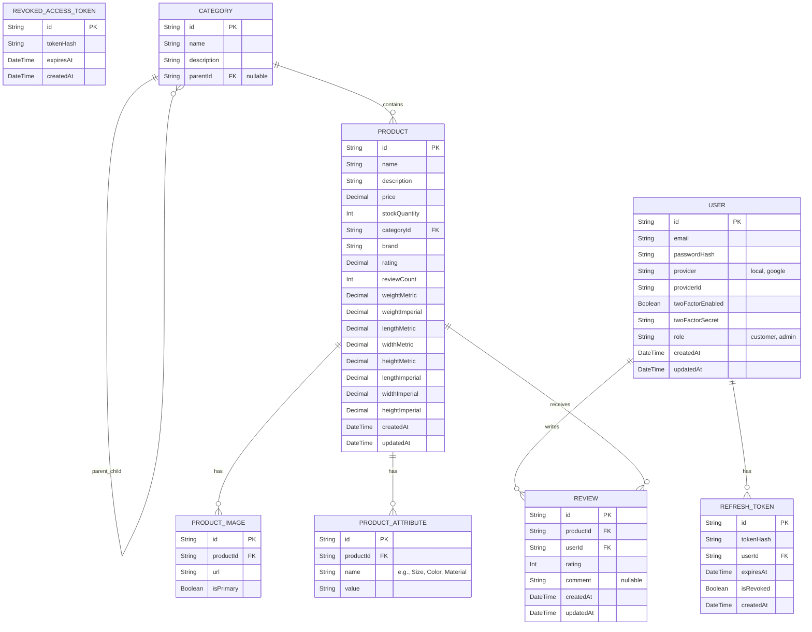

# Project 1: Foundation - Pet-Supplies E-commerce Platform

## Project Overview

This is the backend foundation (Project 1) for a B2C E-commerce platform focused on Pet Supplies. **The platform implements a Business-to-Consumer (B2C) e-commerce model.** It provides a robust, scalable, and secure API for User Management (Authentication, Authorization, 2FA, OAuth) and a highly capable Product Catalog (Faceted search, Dynamic suggestions). 

It is built using:
- **Node.js, Express, TypeScript** for the API.
- **PostgreSQL** for an ACID-compliant relational database.
- **Prisma** as a type-safe ORM.
- **Docker & Docker Compose** for one-click containerization.

## Setup and Installation Instructions

This project is fully containerized. The only prerequisite is to have **Docker** and **Docker Compose** installed on your machine.

1. **Clone the repository** (if applicable) and navigate to the root directory.
2. **Start the application** by running the following command:

```bash
docker-compose up --build
```

This single command will:
1. Pull and start a PostgreSQL 15 container for the database.
2. Build the Node.js API container and run Prisma migrations automatically.
3. Build the React SPA frontend container using Nginx.
4. Start the Express server on `http://localhost:3000`.
5. Start the React frontend on `http://localhost:5173`.

## Testing

Automated tests are written using Jest and Supertest. 
To run the test suite locally (requires `npm install` first):

```bash
npm run test
```

*Note: Ensure you have Node.js installed if you wish to run the tests locally outside of the Docker container.*

## Usage Guide

### Frontend Application
Once the Docker containers are running, you can access the branded **HappyPets** frontend at:
* **`http://localhost:5173`**

From there, you can Register, Login, browse the faceted Product Catalog, and manage your account.

### Backend API Endpoints

#### Authentication (`/api/auth`)
*   `POST /api/auth/register`: Register a new user (requires `email`, `password`, and a mock `captchaToken: "valid_mock_token"`).
*   `POST /api/auth/login`: Login and receive a short-lived Access Token in the payload and a long-lived Refresh Token in an HttpOnly cookie.
*   `POST /api/auth/refresh`: Perform Refresh Token Rotation. Uses the HttpOnly cookie to issue a new Access/Refresh token pair.
*   `POST /api/auth/logout`: Revoke the current refresh token and clear the cookie.
*   `POST /api/auth/2fa/generate`: Generate a TOTP 2FA secret and QR code URL (Requires Auth).
*   `POST /api/auth/2fa/verify`: Verify and enable 2FA on the account.
*   `POST /api/auth/forgot-password`: Send a mock password reset email.
*   `POST /api/auth/reset-password`: Reset password using the token sent to email.
*   `GET /api/auth/google`: Initiate Google OAuth flow.

### Product Catalog (`/api/products`)
*   `GET /api/products`: Retrieve products. Supports faceted search and pagination via query parameters:
    *   `q`: Search by name or description.
    *   `categoryId`, `brand`: Filter by specific category or brand.
    *   `minPrice`, `maxPrice`: Filter by price range.
    *   `sortBy`, `sortOrder`: Sort by attributes (e.g., `sortBy=price&sortOrder=asc`).
    *   `page`, `limit`: Pagination controls.
*   `GET /api/products/suggest`: Dynamic search suggestions (returns top 5 matches based on `q` param).
*   `GET /api/products/:id`: Get detailed product information including images and attributes.
*   `POST /api/products`: Create a new product (Requires Auth & Admin role).
*   `GET /api/products/categories`: Get category tree.
*   `POST /api/products/categories`: Create a new category (Requires Auth & Admin role).

## Entity Relationship Diagram (ERD)

The database schema guarantees ACID properties through PostgreSQL. Below is the Entity Relationship Diagram:



## Bonus Functionality
*   **Refresh Token Rotation**: Implemented to drastically reduce the risk of token theft. Using a stolen refresh token immediately renders it invalid (if checked against db state appropriately).
*   **Faceted Search & Suggestions**: Product endpoints natively support advanced filtering and dynamic type-ahead suggestions for a robust shopping experience.
*   **Security Layers**: Helmet.js for secure HTTP headers, Rate Limiting to prevent brute-force attacks.
