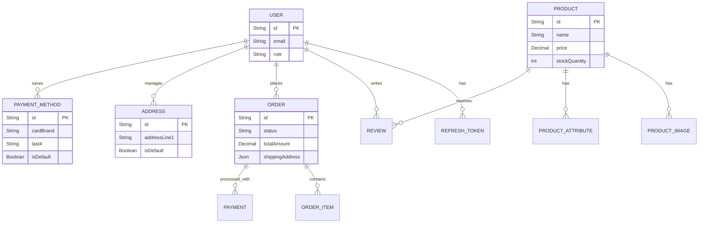

# HappyPets - Full Stack E-commerce Platform

## Project Overview

**HappyPets** is a fully-featured, production-ready Business-to-Consumer (B2C) e-commerce platform focused on Pet Supplies. This repository contains both the robust backend API and the beautifully designed React SPA frontend.

The platform includes comprehensive features required for a modern e-commerce application, including secure authentication, a faceted product catalog, shopping cart functionality, a checkout flow with Stripe integration, order management, and a rich user dashboard (featuring Address Book and Payment Methods management).

It is built using:
- **Frontend:** React, TypeScript, Vite, Lucide React (Icons), and plain CSS for a custom, glassmorphic UI.
- **Backend:** Node.js, Express, TypeScript for the API.
- **Database:** PostgreSQL for an ACID-compliant relational database, managed via Prisma ORM.
- **Messaging/Workers:** RabbitMQ for asynchronous tasks (e.g., order confirmation emails).
- **Infrastructure:** Docker & Docker Compose for seamless one-click containerization and deployment.

## Setup and Installation

This project is fully containerized. The only prerequisite is to have **Docker** and **Docker Compose** installed on your machine.

1. **Clone the repository** and navigate to the root directory.
2. **Start the application** by running the following command:

```bash
docker-compose up --build -d
```

This single command will:
1. Pull and start a PostgreSQL container for the database.
2. Pull and start a RabbitMQ container for message queuing.
3. Build the Node.js API container, run Prisma migrations automatically, and start the Express server on `http://localhost:3000`.
4. Build the React frontend container using Nginx and serve it on `http://localhost:5173`.
5. Start the Mailhog container for local email testing.

## Local Email Testing
All outgoing emails (Order Confirmations, Payment Statuses, etc.) are intercepted locally by **Mailhog** so they don't actually send to real inboxes during testing. 
To view intercepted emails, simply open a new browser tab and navigate to the Mailhog Web UI:
* **`http://localhost:8025`**

## Usage Guide

### Frontend Application
Once the Docker containers are running, you can access the branded **HappyPets** frontend at:
* **`http://localhost:5173`**

Features available in the UI:
- **Authentication:** Register, Login, 2FA Setup, OAuth (Google).
- **Shopping:** Browse products, faceted search, add to cart, adjust quantities.
- **Checkout:** Seamless Stripe-simulated checkout flow with shipping options and payment breakdown.
- **User Dashboard:** View past orders, manage Profile & Security, save Shipping Addresses (Address Book), and securely store mock Payment Methods.

### Backend API Features

#### Authentication & Security
- Complete JWT-based authentication with **Refresh Token Rotation**.
- Two-Factor Authentication (TOTP) generation and verification.
- Password reset flows and Google OAuth integration.
- Rate limiting and Helmet.js for secure HTTP headers.

#### Product Catalog
- Advanced filtering: Search by query, filter by category/brand, price ranges.
- Dynamic search suggestions (type-ahead).
- Detailed product pages including multiple images and variations.

#### Cart & Checkout
- Persistent carts for both authenticated users and guests.
- Checkout initialization, stripe intent generation, and order processing.
- Shipping options (Standard, Express, Overnight) mapped to costs.

#### Orders & Dashboard
- Retrieve user orders and status.
- Address Book management endpoints.
- Payment Methods management endpoints.

## Entity Relationship Diagram (ERD)

The database schema guarantees ACID properties through PostgreSQL. Below is the core Entity Relationship Diagram:



## Bonus Functionality
* **Asynchronous Email Processing**: When an order is placed, a message is queued to RabbitMQ and processed by a background worker to send confirmation emails, ensuring the checkout API responds instantly without waiting for the email service.
* **Refresh Token Rotation**: Implemented to drastically reduce the risk of token theft.
* **Modern Premium UI**: The frontend utilizes glassmorphism, responsive design, and fluid animations to provide a top-tier user experience.
