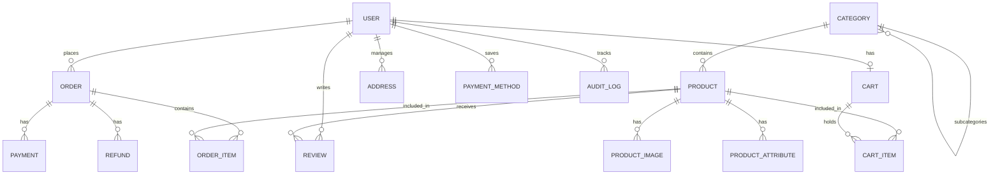

# I Love Shopping E-Commerce Platform

Welcome to the **I Love Shopping** e-commerce platform! This project is a full-stack, production-ready web application built with modern web technologies, focusing on exceptional user experience, top-tier security, and optimal performance.

## Project Overview
The platform offers a seamless shopping experience for premium pet supplies. Key features include:
- **Responsive & Accessible UI**: Adheres to WCAG 2.1 Level A criteria and features a vibrant, glassmorphic design that looks stunning on desktop and mobile.
- **Robust Security**: Enforces strict Content Security Policy (CSP), TLS, token-bucket rate limiting, 2FA (TOTP), and Principle of Least Privilege for admin accounts.
- **Optimized Search & SEO**: High-performance PostgreSQL full-text search combined with dynamically injected meta tags and semantic HTML to rank higher on search engines.

---

## Entity Relationship Diagram
The backend relies on a normalized PostgreSQL database managed by Prisma. Below is the simplified core entity relationship diagram:



---

## Performance Analysis Report

We took a multi-layered approach to ensure lightning-fast response times:

1. **Database Search Optimization**
   Instead of using slow `LIKE` wildcard searches which perform full table scans, the search functionality uses **PostgreSQL's Full-Text Search vectors (`tsvector`)** via Prisma's `search` feature. This provides a balance of highly accurate natural language search and drastically reduced response times.

2. **CDN Strategy for Content Delivery**
   To optimize the delivery of static assets and user-uploaded images in a production environment:
   - **Static Assets (JS/CSS)**: Configured to be aggressively cached and served via a global CDN (such as Cloudflare) positioned in front of the application.
   - **User Uploads / Images**: Instead of serving uploaded files directly from the Node container's filesystem, production setups should sync `/uploads` to an **AWS S3 Bucket** distributed by **Amazon CloudFront**. This offloads heavy image serving from the API and ensures images load instantly from edge locations worldwide.

3. **Frontend Architecture**
   Built with Vite and React, the frontend leverages aggressive code-splitting. Assets are minified and served via highly-performant Nginx containers running on HTTP/2 (TLS).

---

## Prerequisites
- **Docker** and **Docker Compose**
- **Stripe CLI** (Required for payment simulation)

## Setup and Installation

Containerization via Docker makes running this project incredibly simple. 
You do not need to install Node.js, PostgreSQL, or RabbitMQ locally—everything is bundled.

1. **Clone the repository:**
   ```bash
   git clone <repository-url>
   cd i-love-shopping3
   ```

2. **Start the environment:**
   Use the provided quickstart script to build and start the containers.
   ```bash
   chmod +x start.sh
   ./start.sh
   ```
   *(Alternatively, run `docker-compose up --build -d`)*

3. **Verify the services:**
   - **Frontend**: https://localhost
   - **Backend API**: http://localhost:3000
   - **Prisma Studio (DB Admin)**: http://localhost:5555
   - **MailHog (Email testing)**: http://localhost:8025

---

## Usage Guide

### Simulating Payments
The checkout process integrates securely with Stripe. To complete an order and simulate a successful payment locally, use the Stripe CLI:

1. **Login to Stripe CLI** (Ensure you have a Stripe account):
   ```bash
   stripe login
   ```
2. **Listen for webhooks** and forward them to your local API container:
   ```bash
   stripe listen --forward-to http://localhost:3000/api/payments/webhook
   ```
3. Place an order on `https://localhost` using the mock Stripe test card `4242 4242 4242 4242`. The webhook will be triggered, completing the order!

### Accessing Admin Tools
- **Prisma Studio**: Visit `http://localhost:5555` to view and modify raw database records.
- **Admin Dashboard**: Login to the main site with a user assigned the `admin` or `superadmin` role to access administrative settings. Actions performed by admins are tracked in the `AuditLog` table for security and compliance.

---

## Bonus Features Implemented

1. **Accessibility (WCAG 2.1 Level A)**
   - Strict adherence to semantic HTML (`<main>`, properly nested headings).
   - Global `aria-labels`, `htmlFor` mappings, and visually distinct `:focus-visible` rings for keyboard navigation.
   - Relative `rem` typography, ensuring layouts remain flawless at 200% zoom.
2. **Advanced Security (Principle of Least Privilege)**
   - Implemented an `AuditLogger` middleware capturing critical administrative actions.
   - Constrained role modifications: Standard admins cannot elevate privileges; only a designated `superadmin` can.
3. **Automated TLS & Reverse Proxy**
   - Self-signed TLS certificates are provided for secure `https` transmission, with Nginx proxying traffic securely between the React frontend and Node backend. 
