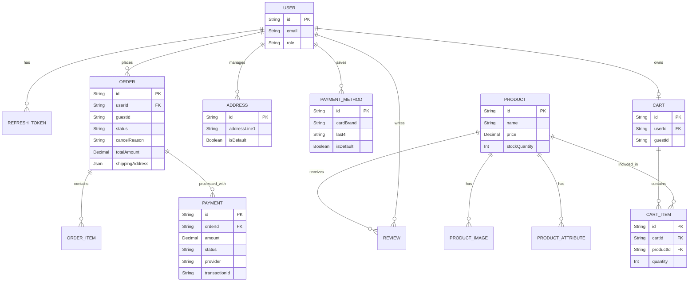

# HappyPets - Full Stack E-commerce Platform

## Project Overview

**HappyPets** is a fully-featured, production-ready Business-to-Consumer (B2C) e-commerce platform focused on Pet Supplies. This repository contains both the robust backend API and the beautifully designed React SPA frontend.

The platform includes comprehensive features required for a modern e-commerce application, including secure authentication, a faceted product catalog, shopping cart functionality, a secure checkout flow with Stripe integration, advanced order management, and a rich user dashboard.

It is built using:
- **Frontend:** React, TypeScript, Vite, Lucide React (Icons), and plain CSS for a custom, glassmorphic UI.
- **Backend:** Node.js, Express, TypeScript for the API.
- **Database:** PostgreSQL for an ACID-compliant relational database, managed via Prisma ORM.
- **Messaging/Workers:** RabbitMQ for asynchronous tasks (e.g., order confirmation emails, inventory deductions, refunds).
- **Infrastructure:** Docker & Docker Compose for seamless one-click containerization and deployment.

## Setup and Installation

This project is fully containerized. The only prerequisite is to have **Docker** and **Docker Compose** installed on your machine.

1. **Clone the repository** and navigate to the root directory.
2. **Start the application** by running the following command:

```bash
docker-compose up --build -d
```

This single command will:
1. Pull and start a PostgreSQL container for the database.
2. Pull and start a RabbitMQ container for message queuing.
3. Build the Node.js API container, run Prisma migrations automatically, and start the Express server on `http://localhost:3000`.
4. Build the React frontend container using Nginx and serve it on `http://localhost:5173`.
5. Start the Mailhog container for local email testing.

**Important:** The database will initially be empty. To populate it with mock users and products, run the seed script:

```bash
npx prisma db seed
```

**Seeded Mock Users:**
- **Admin**: `admin@happypets.com` | Password: `Password123!`
- **Customer**: `customer@happypets.com` | Password: `Password123!`

## Local Email Testing
All outgoing emails (Order Confirmations, Payment Statuses, etc.) are intercepted locally by **Mailhog** so they don't actually send to real inboxes during testing. 
To view intercepted emails, simply open a new browser tab and navigate to the Mailhog Web UI:
* **`http://localhost:8025`**

## Usage Guide

### Frontend Application
Once the Docker containers are running, you can access the branded **HappyPets** frontend at:
* **`http://localhost:5173`**

Features available in the UI:
- **Authentication:** Register, Login, 2FA Setup, OAuth (Google).
- **Shopping:** Browse products, faceted search, add to cart, adjust quantities.
- **Checkout:** Seamless Stripe-simulated checkout flow with shipping options and payment breakdown.
- **User Dashboard:** View past orders, manage Profile & Security, save Shipping Addresses (Address Book), and securely store mock Payment Methods.
- **Guest Tracking:** Guests can track and cancel their orders securely using an Order ID and Email combination via magic links.

## Architecture & Security Updates

This project places a heavy emphasis on enterprise-grade architecture and robust security:

- **PCI-Compliant Payments:** Raw card details never touch our server. The integration utilizes Stripe's `SetupIntent` and `PaymentElement` to securely vault card data. Webhooks ensure atomic updates using Prisma `updateMany` to prevent duplicate processing, and the Stripe `transactionId` is securely stored.
- **RabbitMQ Dead-Letter Queues (DLQ):** The asynchronous messaging architecture implements a Dead-Letter Exchange (DLX) and Dead-Letter Queue (DLQ). This ensures that any failed background jobs (like payment webhooks, emails, or refunds) are never silently dropped, allowing for reliable retry mechanisms.
- **IDOR Prevention:** Order endpoints are strictly scoped to the user's `userId` (via JWT) or their `guestId` (via cookies or explicitly passed credentials). This effectively prevents Insecure Direct Object Reference (IDOR) vulnerabilities where users could access or cancel others' orders.
- **Robust Cart & Checkout:** Fixes have been implemented to prevent negative quantities in the cart, gracefully handle expired JWT tokens (returning `401 Unauthorized`), and prevent race conditions that could lead to duplicate pending orders or duplicated address entries.

## Testing

The project includes a comprehensive suite of unit and integration tests using Jest and Supertest.

### Isolated Test Environment
Tests now run against a completely isolated test database (`happypets_test`) to prevent accidental data loss in your development database. This ensures operations like `deleteMany()` are completely safe.

To run the test suite locally on your host machine, make sure your Docker containers are running (so the database server is accessible) and execute:

```bash
npm run test:local
```

This script automatically loads the `.env.test` file using `dotenv-cli`, configuring Jest to target the isolated test database, runs migrations to ensure the schema is fresh, and executes the integration tests securely.

## Entity Relationship Diagram (ERD)

The database schema guarantees ACID properties through PostgreSQL. Below is the updated core Entity Relationship Diagram reflecting our newest architectural additions:


